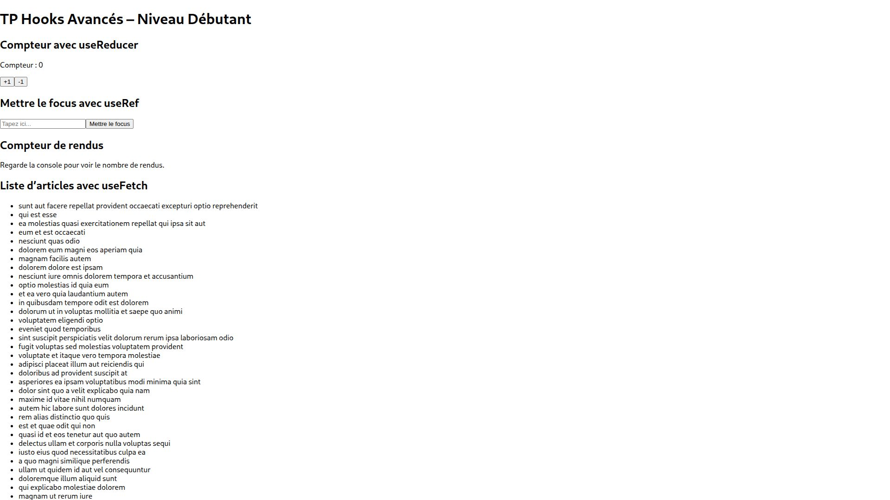
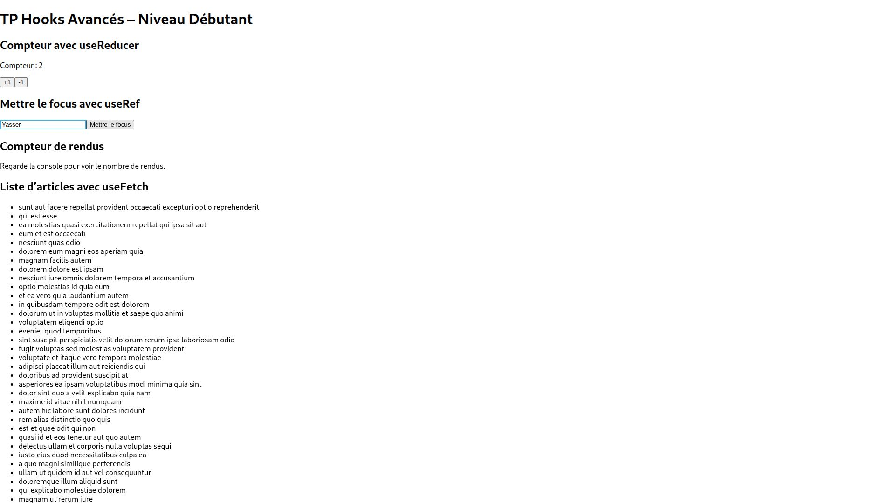
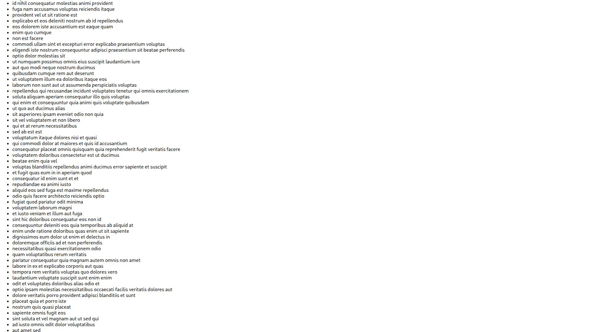
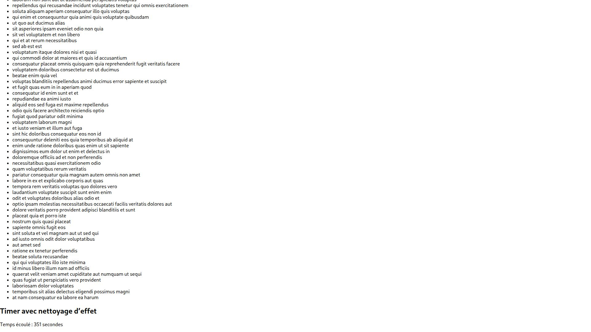

# Lab6-tp-hooks-debutant

**Réalisé par : Yasser**

Compteur avec useReducer, focus avec useRef, articles avec useFetch et timer.

Compteur à 2 et champ contenant « Yasser » avec le focus.

La liste contient les 100 articles de JSONPlaceholder.

Le timer affiche le temps écoulé sous la liste.

